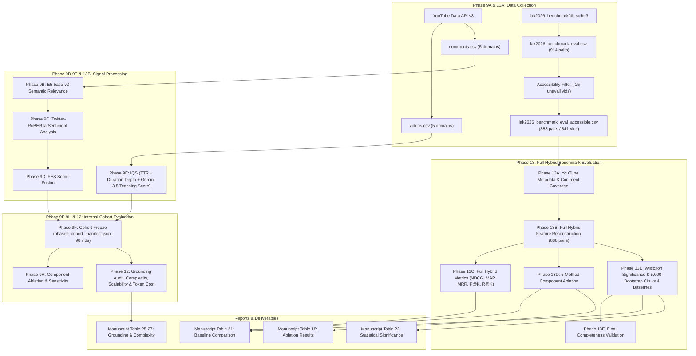

# End-to-End Dependency Map & Data Provenance

**Project Title:** Explainable Educational Video Ranking Using Hybrid Semantic Intelligence and LLM-Assisted Engagement Analysis  
**Author:** Chennareddy Nayanesh Reddy  

---

## 1. High-Level Dataflow Architecture

The pipeline consists of two distinct evaluation pathways:
1. **Internal Multi-Domain Cohort Pathway (Phase 9–12):** Evaluates YouTube educational videos across 5 domains to analyze engagement signals, intrinsic quality, adaptive weighting, runtime scalability, and explanation grounding.
2. **External LAK 2026 Benchmark Pathway (Phase 10, 11, 13):** Reconstructs features for accessible LAK benchmark items and performs formal ranking evaluations against independent human expert relevance judgments.

---

## 2. Granular Stage-by-Stage Traceability Matrix

### Stage 1: Retrieval & Preprocessing (Phase 9A, 9B, 9C)
* **Input:** YouTube Data API v3 search queries across 5 domains (`Programming`, `Data Science`, `Mathematics`, `Physics`, `Biology`).
* **Producer:** `notebooks/NLP_REVISION_v17_LAK_HYBRID_COMPLETE.ipynb` (Cell 10–12) / `src/retrieval.py`
* **Outputs Generated:**
  - `data/raw/youtube_5domains/<domain>/videos.csv`
  - `data/raw/youtube_5domains/<domain>/comments.csv`
  - `data/processed/phase9b/<domain>/comments_cleaned.csv`
  - `data/processed/phase9b/<domain>/comments_relevant.csv`
  - `data/processed/phase9c/<domain>/relevant_comments_sentiment.csv`
  - `data/processed/phase9c/<domain>/video_emotional_engagement.csv`
* **Downstream Consumers:** Consumed by Phase 9D FES computation.

### Stage 2: Feature-based Engagement Score (Phase 9D)
* **Input:** Domain-level video emotional engagement and normalized likes/comments.
* **Producer:** Cell 13 / `src/fes.py`
* **Formula:** $\text{FES}_i = 0.4 \cdot \text{EE}_i + 0.2 \cdot (1 - \text{EV}_i) + 0.2 \cdot \text{LikesNorm}_i + 0.2 \cdot \text{CommentsNorm}_i$
* **Outputs Generated:**
  - `data/processed/phase9d/phase9d_fes_full.csv` (98 rows)
  - `data/processed/phase9d/phase9d_fes_top10.csv`
* **Downstream Consumers:** Consumed by Phase 9F Adaptive Hybrid Ranking.

### Stage 3: Intrinsic Quality Score (Phase 9E)
* **Input:** Video descriptions, duration, transcripts, and LLM pedagogical rubric prompts.
* **Producer:** Cells 14–16 / `src/iqs.py`, `src/preprocessing.py`
* **Formula:** $\text{IQS}_i = 0.3 \cdot \text{SemanticAlignment}_i + 0.2 \cdot \text{DepthScore}_i + 0.2 \cdot \text{TTR}_i + 0.3 \cdot \text{TeachingScore}_i$
* **Outputs Generated:**
  - `data/processed/phase9e/phase9e_iqs_components.csv` (98 rows)
  - `data/processed/phase9e/phase9e_iqs_full.csv` (98 rows)
  - `data/processed/phase9e/teaching_score_results/teaching_scores.csv`
* **Downstream Consumers:** Consumed by Phase 9F Adaptive Hybrid Ranking.

### Stage 4: Authoritative Cohort Freeze & Adaptive Hybrid Fusion (Phase 9F)
* **Input:** `phase9d_fes_full.csv` and `phase9e_iqs_full.csv`.
* **Producer:** Cell 17, 24 / `src/hybrid_ranking.py`
* **Formula:**
  - $\text{ES}_i = \ln(1 + C_i^{\text{rel}})$
  - $\alpha_i = \min(1.0, \text{ES}_i / 5.0)$
  - $\text{Hybrid}_i = \alpha_i \cdot \text{FES}_i + (1 - \alpha_i) \cdot \text{IQS}_i$
* **Outputs Generated:**
  - `data/processed/phase9f/phase9_cohort_manifest.json` (authoritative cohort: 98 videos)
  - `data/processed/phase9f/phase9f_hybrid_full.csv` (98 rows)
  - `data/processed/phase9f/phase9f_alpha_summary.csv`
* **Downstream Consumers:** Consumed by Phase 9H ablation, Phase 12 extended audits.

### Stage 5: Full LAK Benchmark Feature Reconstruction & Evaluation (Phase 13)
* **Input:**
  - `data/benchmark/lak2026_benchmark_eval_accessible_888.csv` (888 pairs, 54 topics, 841 unique videos)
  - `data/benchmark/lak_youtube_metadata_841.csv`
  - `data/benchmark/lak_youtube_comments.csv` (31,603 usable comments)
  - `data/benchmark/lak_teaching_scores.csv`
* **Producer:** `notebooks/NLP_REVISION_v17_LAK_HYBRID_COMPLETE.ipynb` (Cells 78–83) / `src/evaluation.py`, `src/significance.py`
* **Outputs Generated:**
  - `results/lak_benchmark/phase13_full_hybrid_evaluation/phase13_lak_hybrid_components.csv` (888 rows)
  - `results/lak_benchmark/phase13_full_hybrid_evaluation/phase13_lak_hybrid_predictions.csv` (888 rows)
  - `results/lak_benchmark/phase13_full_hybrid_evaluation/phase13_lak_hybrid_topic_metrics.csv` (54 topics)
  - `results/lak_benchmark/phase13_full_hybrid_evaluation/phase13_lak_hybrid_component_ablation.csv` (5 methods)
  - `results/lak_benchmark/phase13_full_hybrid_evaluation/phase13_lak_hybrid_vs_baselines_summary.csv` (Hybrid vs BM25, E5, DPR, RankNet across 8 metrics)
  - `results/lak_benchmark/phase13_full_hybrid_evaluation/phase13_lak_hybrid_vs_baselines_significance.csv` (32 Wilcoxon comparisons across 54 topics)
  - `results/lak_benchmark/phase13_full_hybrid_evaluation/phase13_lak_hybrid_bootstrap_ci.csv` (5,000 bootstrap CI rounds)
  - `results/lak_benchmark/phase13_full_hybrid_evaluation/phase13_lak_hybrid_completeness_check.csv`
* **Downstream Consumers:** Directly populates Tables 18, 20, 21, and 22 in the final research manuscript and reviewer response letter.
