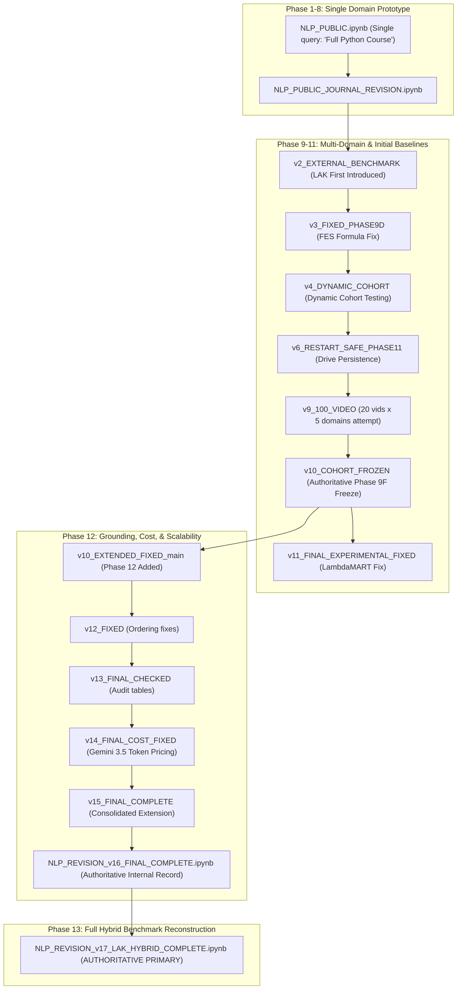

# Notebook Version Map & Lineage Analysis

**Project Title:** Explainable Educational Video Ranking Using Hybrid Semantic Intelligence and LLM-Assisted Engagement Analysis  
**Author:** Chennareddy Nayanesh Reddy  

---

## 1. Executive Summary of Notebook Roles

Across the project trajectory, the experimental notebooks evolved from an exploratory single-domain pilot to a multi-domain internal cohort evaluation, and ultimately into a full hybrid reconstruction evaluated against the external LAK 2026 expert benchmark.

| Notebook Filename | Evolution Stage | Status | Primary Purpose & Role |
|:---|:---|:---|:---|
| **`NLP_REVISION_v17_LAK_HYBRID_COMPLETE.ipynb`** | Phase 9–13 | **Primary Authoritative** | **The central deliverable of the project.** Reconstructs full Hybrid features across 888 accessible LAK pairs (841 unique videos, 54 topics), evaluates NDCG/MAP/MRR/P/R, executes full component ablation, runs paired Wilcoxon significance tests against BM25/E5/DPR/RankNet, and computes 5,000-sample bootstrap CIs. |
| **`NLP_REVISION_v16_FINAL_COMPLETE.ipynb`** | Phase 9–12 | **Authoritative Supporting** | Authoritative experimental record for the 5-domain internal cohort pipeline (Phase 9A–9K), LambdaMART & Popularity baselines (Phase 11), explanation grounding audit, token monetary cost accounting, and empirical scalability analysis (Phase 12). |
| **`NLP_REVISION_v15_FINAL_COMPLETE.ipynb`** | Phase 9–12 | Historical Checkpoint | Checkpoint prior to v16 final cleanup; contains Phase 12 extension analyses before baseline consolidation. |
| **`NLP_REVISION_v14_FINAL_COST_FIXED.ipynb`** | Phase 9–12 | Historical Checkpoint | Specifically refined the token-based monetary cost estimation model for Gemini 3.5 Flash-Lite. |
| **`NLP_REVISION_v13_FINAL_CHECKED.ipynb`** | Phase 9–12 | Historical Checkpoint | Initial comprehensive integration of Phase 12 error analysis, complexity analysis, and grounding audits. |
| **`NLP_REVISION_v12_FIXED.ipynb`** | Phase 9–11 | Historical Checkpoint | Fixed early execution ordering and dependency issues in Phase 11 baseline evaluations. |
| **`NLP_PUBLIC_JOURNAL_REVISION_v11_FINAL_EXPERIMENTAL_FIXED.ipynb`** | Phase 9–11 | Historical Checkpoint | Stabilized LambdaMART feature importance extraction and popularity comparison tables. |
| **`NLP_PUBLIC_JOURNAL_REVISION_v10_EXTENDED_FIXED_main.ipynb`** | Phase 9–12 | Historical Milestone | Introduced the extended journal revision sections (Phase 12), expanding beyond preliminary baselines. |
| **`NLP_PUBLIC_JOURNAL_REVISION_v10_COHORT_FROZEN.ipynb`** | Phase 9–10 | Historical Milestone | Critical architectural milestone: introduced the strict **Phase 9F cohort freeze** to prevent dynamic retrieval drift in downstream ablation. |
| **`NLP_PUBLIC_JOURNAL_REVISION_v9_100_VIDEO_FINAL_VALIDATED.ipynb`** | Phase 9 | Historical Iteration | Target cohort testing aiming for 20 videos × 5 domains = 100 videos prior to zero-comment filtering. |
| **`NLP_PUBLIC_JOURNAL_REVISION_v8_FINAL_VALIDATED.ipynb`** | Phase 9 | Historical Iteration | Precursor multi-domain data collection verification. |
| **`NLP_PUBLIC_JOURNAL_REVISION_v7_FINAL_VALIDATED.ipynb`** | Phase 9 | Historical Iteration | Multi-domain pipeline stabilization. |
| **`NLP_PUBLIC_JOURNAL_REVISION_v6_RESTART_SAFE_PHASE11.ipynb`** | Phase 9–11 | Historical Milestone | Introduced Google Drive persistence and restart-safe checkpointing for long-running Colab sessions. |
| **`NLP_PUBLIC_JOURNAL_REVISION_v4_DYNAMIC_COHORT.ipynb`** | Phase 9 | Historical Exploration | Explored dynamic cohort filtering before freezing was formally adopted at Phase 9F. |
| **`NLP_PUBLIC_JOURNAL_REVISION_v3_FIXED_PHASE9D.ipynb`** | Phase 9 | Bug Fix Milestone | Corrected Feature-based Engagement Score (FES) normalization and inverted variance weighting. |
| **`NLP_PUBLIC_JOURNAL_REVISION_v2_EXTERNAL_BENCHMARK.ipynb`** | Phase 10 | Historical Milestone | First prototype integrating the external LAK 2026 expert relevance benchmark. |
| **`NLP_PUBLIC_JOURNAL_REVISION.ipynb`** | Phase 1–8 | Legacy Baseline | Multi-domain expansion of the original prototype. |
| **`NLP_PUBLIC.ipynb`** | Phase 1–8 | Initial Prototype | Earliest experimental prototype evaluated solely on the single search query "Full Python Course". |

---

## 2. Structural Relationships & Succession

---

## 3. Why Notebook v17 is the Definitive Master

1. **Complete Hybrid Feature Reconstruction (Phase 13B):** Earlier notebooks (v10–v16) evaluated BM25, E5, and simple baselines on LAK, but evaluated the full Hybrid pipeline only on the internal 98-video cohort. Notebook v17 reconstructs full E5 semantic relevance, RoBERTa sentiment, FES, and IQS directly across all accessible LAK benchmark items.
2. **Unified Common Cohort Evaluation (Phase 13C–13E):** Directly evaluates 888 accessible topic-video pairs across 54 topics, ensuring every baseline (BM25, E5, DPR, RankNet) is evaluated on the exact same dataset without representation bias.
3. **Rigorous Statistical Significance (Phase 13E):** Executes paired Wilcoxon signed-rank tests across 54 topics and calculates 5,000-sample bootstrap confidence intervals, reproducing the exact findings reported in manuscript Table 21 and Table 22.
4. **All Outputs Fully Preserved:** Contains complete saved outputs verifying the full execution of Phase 13A through Phase 13F.
